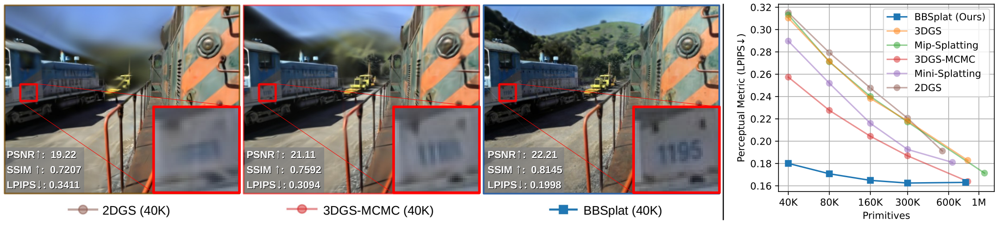
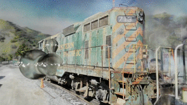
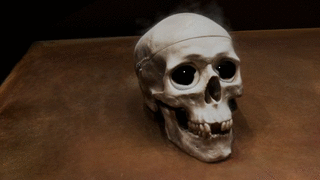
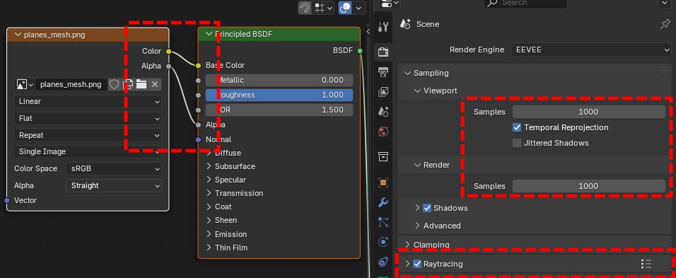
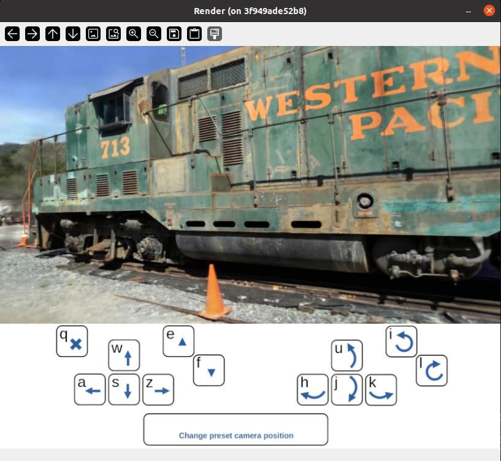

# BBSplat (BillBoard Splatting): 새로운 시점 합성을 위한 학습 가능한 텍스처 프리미티브

> **원본 프로젝트**: [프로젝트 페이지](https://david-svitov.github.io/BBSplat_project_page/) | [논문](https://arxiv.org/pdf/2411.08508) | [영상](https://youtu.be/ZnIOZHBJ4wM) | [BBSplat Rasterizer (CUDA)](https://github.com/david-svitov/diff-bbsplat-rasterization/) | [씬 예시 (1.5GB)](https://drive.google.com/file/d/1gu_bDFXx38KJtwIrXo8lMVtuY-P2PFXX/view?usp=sharing)

> **이 저장소는 PlanarSnap 프로젝트를 위한 포크입니다.** 원본 BBSplat에 여러 버그 수정 및 학습 품질 개선이 적용되었습니다.



---

## 개요

BBSplat은 텍스처가 있는 기하학적 프리미티브 기반의 새로운 시점 합성 방법입니다. 씬을 최적화 가능한 텍스처 평면 프리미티브의 집합으로 표현하며, 학습 가능한 RGB 텍스처와 알파맵으로 형태를 제어합니다. BBSplat 프리미티브는 기존 Gaussian Splatting 파이프라인에서 가우시안의 드롭인 대체재로 사용할 수 있습니다.

평면 프리미티브의 명시적인 특성 덕분에 2DGS 프레임워크와 유사하게 정확한 3D 메쉬를 추출할 수 있고, 레스터화 과정에서 레이트레이싱 효과도 활용할 수 있습니다. 스파스한 텍스처 구조를 유도하는 정규화 항을 통해 효율적인 압축이 가능하며, 3DGS 대비 최대 17배 저장공간을 절감합니다. Tanks&Temples, DTU, Mip-NeRF-360 데이터셋에서 우수한 성능을 보이며, DTU Full HD 해상도에서 29.72 dB PSNR을 달성합니다.

---

## 업데이트 (원본 BBSplat)

- 2025-02-10: FPS 측정 함수 버그 수정 및 프리프린트 업데이트
- 2025-03-13: 메쉬 추출 코드 공개

---

## 이 포크의 수정 사항

### 1. Float32 텍스처 저장/불러오기 (핵심 버그 수정)

**문제**: 원본 코드는 텍스처를 uint8 델타 인코딩으로 저장했습니다. 이때 완전 투명한 픽셀의 `-inf` 로짓 값이 작은 양수값(~0.004 alpha)으로 변환되어, 모델 로드 후 많은 빌보드에서 미세한 밝기 기여가 누적되었습니다. 결과적으로 **9~13 dB PSNR 손실** 및 갈색으로 뿌연 시각적 아티팩트가 발생했습니다.

**수정**: `save_texture()`가 raw float32 파라미터를 직접 저장하도록 변경했습니다. `load_texture()`는 dtype을 자동 감지하여 float32(새 형식)와 uint8(기존 형식) 모두 지원합니다.

```python
# scene/gaussian_model.py — save_texture()
def save_texture(self, folder_path):
    ta_f32 = self._texture_alpha.detach().cpu().numpy().astype(np.float32)
    tc_f32 = self._texture_color.detach().cpu().numpy().astype(np.float32)
    np.savez_compressed(os.path.join(folder_path, "texture_alpha.npz"), texture_alpha=ta_f32)
    np.savez_compressed(os.path.join(folder_path, "texture_color.npz"), texture_color=tc_f32)
```

### 2. Scaling/Rotation 학습률 지수 감소

학습이 진행되면서 지오메트리(크기, 회전)가 불안정하게 변화하는 것을 방지하기 위해, scaling과 rotation 파라미터에 지수 감소 학습률 스케줄러를 추가했습니다.

- 초기 학습률 → 30,000 iter에 걸쳐 10%로 감소
- 수렴 이후 빌보드 지오메트리 드리프트를 효과적으로 억제

### 3. PSNR 하락 방지: 3단계 수정 체인

기본값 `densify_until_iter=25000` 대신 **10,000**을 권장하며, 아래 3가지 수정이 함께 적용됩니다.

**문제**: room scene에서 PSNR이 iter 10,000(~26 dB 정점) 이후 iter 32,000까지 ~18~19 dB로 지속 하락.

**수정 1** — `opacity_reg`를 MCMC 종료 후 비활성화:  
`opacity_reg=0.01` 손실 항목이 MCMC 없이 계속 실행되면 모든 billboard alpha를 0으로 밀어냄.

**수정 2** — MCMC 종료 후 geometry(xyz/scaling/rotation) 동결:  
수렴한 지오메트리가 계속 업데이트되면 불필요한 drift 발생.

**수정 3** — MCMC 종료 시 텍스처(alpha/color)도 동결, 이후 SH(f_dc/f_rest)만 학습:  
`activate_texture_training()`이 매 iter 텍스처 LR을 초기값으로 리셋하기 때문에, MCMC 종료 후 고정 LR 업데이트가 수렴한 텍스처를 진동시킴.

**v13 결과 (room scene, cap_max=160k)**:

| Iter | Test PSNR |
|------|-----------|
| 10000 | 26.11 dB |
| 20000 | 26.28 dB |
| 32000 | 26.34 dB |

최종 metrics: PSNR **26.22** / SSIM **0.8298** / LPIPS **0.2999**

**v15 결과 (room scene, cap_max=200k)**:

| Iter | Test PSNR |
|------|-----------|
| 10000 | 26.47 dB |
| 20000 | 26.61 dB |
| 32000 | 26.66 dB |

최종 metrics: PSNR **26.54** / SSIM **0.8367** / LPIPS **0.2897**  
빌보드 수 160k→200k 증가만으로 PSNR +0.32 dB, LPIPS -0.010 개선.

```bash
python train.py -s <데이터셋_경로> --model_path=<출력_경로> \
  --cap_max=200_000 --max_read_points=180_000 --add_sky_box --eval \
  --densify_until_iter 10000
```

### 4. CUDA 12.8 / WSL2 호환성 수정

아래 [CUDA 12.8 + WSL2 호환성](#cuda-128--wsl2-호환성) 섹션 참조.

### 5. 빌보드 노멀 벡터 정확도 수정 (PlanarSnap)

**문제**: 학습된 빌보드의 노멀 벡터(쿼터니언에서 유도한 로컬 Z축)가 실제 표면 방향을 따라가지 않았습니다. 평면별 기하학적 정답 노멀(해당 평면 점들의 SVD 피팅)과 비교한 각도 오차:

| 표면 | 수정 전 (v17) | 무작위 벡터 기준 |
|---|---|---|
| 바닥 | 59.0° | ~57° |
| 벽 | 34.1° | ~57° |

바닥은 무작위와 구분되지 않는 수준이었습니다. `--lambda_normal`을 논문 기준값 0.05로 올려도(v17) 개선되지 않았습니다.

**원인**: 회전 초기화가 `torch.rand((N, 4))`였습니다. 쿼터니언 성분이 모두 양수라 SO(3) 상에서 균일하지 않고, 노멀이 **월드 +X축 부근에 몰립니다**(초기 노멀 평균 벡터 (0.72, 0, 0)). 학습 후에도 이 편향이 거의 그대로 남아(평균 (0.58, 0, 0), 지배 방향이 X축에서 3° 이내), 실제 표면 방향이 아니라 초기화를 반영하고 있었습니다.

벽이 상대적으로 나아 보였던 것은 이 씬에서 벽의 실제 노멀이 우연히 X축과 9° 이내였기 때문이고, 바닥은 X축과 직교(89°)라 무작위처럼 보였던 것입니다. 표면 종류의 문제가 아니라 좌표축 방향의 우연이었습니다.

추가로 노멀 손실이 실제로 작동하는 구간이 매우 짧았습니다 — `lambda_normal`은 iter 7000부터 켜지는데 `--densify_until_iter 10000` 이후에는 rotation 학습률이 0이 되므로, 유효 구간이 3000 iter뿐이었습니다.

**수정**: 두 가지를 추가했습니다.

```python
# scene/gaussian_model.py — 주변 이웃의 PCA 노멀로 회전 초기화
@staticmethod
def pca_normal_rotations(points, k=20):
    _, nbr = cKDTree(points).query(points, k=k)
    local = points[nbr] - points[nbr].mean(axis=1, keepdims=True)
    cov = np.einsum('nki,nkj->nij', local, local)
    normals = np.linalg.eigh(cov)[1][:, :, 0]          # 최소 고유벡터 = 표면 노멀
    normals[normals[:, 2] < 0] *= -1                    # z -> -z 특이점 회피
    q = np.concatenate([1.0 + normals[:, 2:3], -normals[:, 1:2],
                        normals[:, 0:1], np.zeros((len(points), 1))], axis=1)
    return q / np.linalg.norm(q, axis=1, keepdims=True)
```

```python
# train.py — 하드코딩된 7000을 인자로 변경
lambda_normal = opt.lambda_normal if iteration > opt.normal_from_iter else 0.0
```

**결과 (room 씬, v18)**:

| 표면 | 수정 전 (v17) | 수정 후 (v18) |
|---|---|---|
| 바닥 | 59.0° | **26.1°** (중앙값 21.1°) |
| 벽 | 34.1° | **30.6°** (중앙값 25.9°) |
| Test PSNR | 26.36 | 25.97 (−0.39 dB) |

바닥 오차가 절반 이하로 줄었고, 바닥과 벽이 비슷한 수준이 되었습니다(초기화 편향 제거 확인). 렌더링 품질 손실은 0.39 dB입니다.

```bash
python train.py -s <데이터셋_경로> --model_path=<출력_경로> \
  --cap_max=200_000 --max_read_points=180_000 --add_sky_box --eval \
  --densify_until_iter 10000 --lambda_normal=0.05 \
  --rotation_init pca --normal_from_iter 3000
```

> **주의**: 남은 오차 20~30°는 여전히 방향 클러스터링만으로 평면을 분할하기에는 거칩니다(예각으로 만나는 평면들을 구분하기 어려움). 평면 분할은 위치 기반 RANSAC(`segment_planes.py --method ransac`)을 계속 사용합니다. 이 수정의 의의는 빌보드 노멀이 무작위가 아니라 실제 기하 정보를 담고 있음을 확인한 것입니다.
>
> 기본값은 기존 동작(`--rotation_init rand`, `--normal_from_iter 7000`)이라 다른 실험에는 영향이 없습니다.

---

## CUDA 12.8 + WSL2 호환성

**CUDA 12.8** 또는 **WSL2(Windows WDDM)** 환경에서 학습 시 다음 수정사항이 `train.py`에 이미 적용되어 있습니다. 원본 코드를 사용하는 경우 아래 변경사항을 직접 적용해야 합니다.

### train.py 필수 코드 변경사항

**1. 메모리 할당자** — `import torch` 이전에 추가:
```python
import os
os.environ["PYTORCH_CUDA_ALLOC_CONF"] = "expandable_segments:True,garbage_collection_threshold:0.8"
```
densification 이후 WSL2에서 발생하는 CUDA 메모리 단편화 스파이크(30~145초 backward 정지) 방지.

**2. 이미지 크기 16px 정렬** — 매 iter `render()` 호출 전 추가:
```python
viewpoint_cam.image_width  = viewpoint_cam.image_width  - (viewpoint_cam.image_width  % 16)
viewpoint_cam.image_height = viewpoint_cam.image_height - (viewpoint_cam.image_height % 16)
```
GT 이미지도 크롭하여 맞춤: `gt_image = gt_image[:, :viewpoint_cam.image_height, :viewpoint_cam.image_width]`  
CUDA 12.8 타일 레스터라이저가 16의 배수 크기를 요구함. 미적용 시 엣지 시임 아티팩트 또는 크래시 발생.

**3. 파라미터 클램핑** — 매 iter `render()` 전 추가:
```python
with torch.no_grad():
    gaussians._xyz.data = torch.clamp(gaussians._xyz.data, min=-10.0, max=10.0)
    if hasattr(gaussians, '_scaling'):
        gaussians._scaling.data = torch.clamp(gaussians._scaling.data, min=-15.0, max=5.0)
```
MCMC noise injection을 통한 NaN/Inf 전파 방지. 미적용 시 갈색 blob 아티팩트 및 학습 크래시 발생.

**4. MCMC noise에 고정 opacity 사용** — optimizer step 내 `opacity` 줄 교체:
```python
# texture_alpha 기반 opacity 대신:
opacity = torch.ones([gaussians._xyz.shape[0], 1], dtype=torch.float32, device="cuda")
```

### WSL2 전용 OS 수정 (Windows PowerShell 관리자 권한 실행)

```powershell
# GPU 타임아웃 2초 → 60초로 증가 (긴 CUDA 커널 실행 중 드라이버 리셋 방지)
reg add "HKLM\SYSTEM\CurrentControlSet\Control\GraphicsDrivers" /v TdrDelay /t REG_DWORD /d 60 /f
# TDR 완전 비활성화
reg add "HKLM\SYSTEM\CurrentControlSet\Control\GraphicsDrivers" /v TdrLevel /t REG_DWORD /d 0 /f
```

**하드웨어 가속 GPU 스케줄링(HAGS) 비활성화**: 설정 → 시스템 → 디스플레이 → 그래픽 → 기본 그래픽 설정 변경 → 하드웨어 가속 GPU 스케줄링 **끄기**

두 변경사항 모두 **재부팅** 필요.

---

## 저장소 구조

```bash
.
├── scripts                         # 데이터셋 처리용 bash 스크립트
│   ├── colmap_all.sh               # COLMAP으로 포인트 클라우드 추출
│   ├── dtu_eval.py                 # DTU Chamfer distance 평가
│   ├── train_all.sh                # 모든 씬 학습
│   ├── render_all.sh               # 모든 씬 렌더링
│   ├── metrics_all.sh              # 모든 씬 메트릭 계산
│   ├── depth_fusion.py             # (PlanarSnap) 렌더링 깊이 → 조밀 점군
│   ├── hybrid_planes.py            # (PlanarSnap) depth 평면을 빌보드로 정밀화
│   ├── analyze_walls.py            # (PlanarSnap) 벽/방향/수직쌍 집계
│   ├── replica_to_colmap.py        # (PlanarSnap) Replica → COLMAP 변환
│   ├── gt_depth_fusion.py          # (PlanarSnap) GT depth 오라클 점군
│   ├── eval_normals_gt.py          # (PlanarSnap) GT 노멀 정확도
│   ├── eval_walls_gt.py            # (PlanarSnap) GT 벽 검출
│   ├── eval_wall_geometry_gt.py    # (PlanarSnap) GT 벽 평면 기하
│   ├── eval_coverage_gt.py         # (PlanarSnap) 클래스별 표면 커버리지
│   ├── eval_floor_gt.py            # (PlanarSnap) GT up 방향·바닥 높이
│   ├── consolidate_walls.py        # (PlanarSnap) 벽 조각 통합
│   ├── room_polygon.py             # (PlanarSnap) 벽 평면 → 방 다각형
│   ├── eval_footprint_gt.py        # (PlanarSnap) GT 평면도 IoU
│   ├── eval_floorplan_gt.py        # (PlanarSnap) 경계 거리·3D 벽 복원
│   ├── plot_floorplans.py          # (PlanarSnap) 결과 그림 (빌보드 vs depth, 분할 과정, 평면도)
│   ├── run_replica_scene.sh        # (PlanarSnap) 한 씬 전체 파이프라인
│   └── summarize_replica.py        # (PlanarSnap) 5씬 결과 집계
├── submodules
│   ├── diff-bbsplat-rasterization  # BBSplat 레스터라이저 CUDA 구현
│   └── simple-knn                  # KNN CUDA 구현
├── docker                          # Docker 이미지 빌드/실행 스크립트
├── docker_colmap                   # COLMAP용 Docker 이미지
├── bbsplat_install.sh              # 서브모듈 빌드 및 설치
├── convert.py                      # COLMAP으로 포인트 클라우드 추출
├── train.py                        # BBSplat 씬 표현 학습
├── render.py                       # 새로운 시점 합성
├── metrics.py                      # 메트릭 계산
├── visualize.py                    # 인터랙티브 씬 시각화
├── docs
│   └── planarsnap_notion.md        # (PlanarSnap) 연구 전체 정리 문서
├── segment_planes.py               # (PlanarSnap) 평면 분할 (빌보드/depth 점군)
├── save_from_checkpoint.py         # 학습 체크포인트에서 point_cloud 저장
└── test_psnr.py                    # PSNR 진단 스크립트 (preproc=False vs True 비교)
```

---

## 설치

Docker를 이용한 빠른 설치:

```bash
# 클론
git clone https://github.com/david-svitov/BBSplat.git --recursive
cd BBSplat/docker

# Docker 이미지 빌드
bash build.sh
# source.sh에서 마운트 경로 조정 후
bash run.sh

# 컨테이너 내에서 서브모듈 설치
bash bbsplat_install.sh
```

<details>
<summary>COLMAP용 Docker 컨테이너</summary>

```bash
cd BBSplat/docker_colmap
bash run.sh

# 이 컨테이너에서 OpenCV 설치 필요
add-apt-repository universe
apt-get update
apt install python3-pip
python3 -m pip install opencv-python
```
</details>

> **서브모듈 재설치**: `submodules/diff-bbsplat-rasterization/` 내 `.cu` 또는 `.h` 파일 수정 후에는 반드시 `bash bbsplat_install.sh`를 실행해야 합니다.

---

## 데이터 전처리

`convert.py` 사용 예시는 `scripts/colmap_all.sh` 참조.  
COLMAP 출력 폴더에서 데이터셋에 따라 다른 `images_N` 폴더를 사용합니다. 3DGS/2DGS와 동일한 COLMAP 로더를 사용하며, [자세한 설명](https://github.com/graphdeco-inria/gaussian-splatting?tab=readme-ov-file#processing-your-own-scenes)을 참조하세요.

---

## 학습

### 기본 명령어

```bash
python train.py -s <COLMAP 처리된 데이터셋 경로> \
  --cap_max=160_000 --max_read_points=150_000 --add_sky_box --eval
```

### 주요 인자

```bash
--cap_max               # 빌보드 최대 개수
--max_read_points       # 초기화용 SfM 포인트 최대 개수
--add_sky_box           # 원거리 객체용 추가 포인트 생성
--eval                  # N번째 이미지마다 평가용으로 보류
--densify_until_iter    # MCMC densification 종료 iter (권장: 10000)
--lambda_normal         # 노멀 일관성 하이퍼파라미터
--lambda_distortion     # 깊이 왜곡 하이퍼파라미터
--rotation_init         # 빌보드 회전 초기화: rand(기본) | pca (PlanarSnap, 위 5번 항목)
--normal_from_iter      # 노멀 손실 활성화 iter (기본 7000)
```

### 데이터셋별 권장 파라미터

| 데이터셋 | `--cap_max` | `--max_read_points` | 추가 플래그 |
|---|---|---|---|
| Mip-NeRF-360 실내 (room, bonsai, counter, kitchen) | 200,000 | 180,000 | `--add_sky_box --eval --densify_until_iter 10000` |
| Mip-NeRF-360 실외 (bicycle, stump, garden) | 300,000 | 290,000 | `--add_sky_box --eval --densify_until_iter 10000` |
| Tanks & Temples | 300,000 | 290,000 | `--add_sky_box --eval --densify_until_iter 10000` |
| DTU | 60,000 | 60,000 | `--lambda_normal=0.05 --lambda_dist 100 --eval` |

---

## 테스트

### 새로운 시점 합성 평가

```bash
python render.py -m <학습된 모델 경로> -s <COLMAP 데이터셋 경로>
```

```bash
--skip_mesh     # 메쉬 추출 비활성화 (NVS 평가 가속)
--save_planes   # BBSplat을 텍스처 평면 집합으로 저장
```

메트릭 계산:
```bash
python metrics.py -m <학습된 모델 경로>
```

---

❗ **빠른 추론**

`submodules/diff-bbsplat-rasterization/cuda_rasterizer/auxiliary.h`에서 `#define FAST_INFERENCE 0`을 `1`로 변경한 뒤 `bash bbsplat_install.sh`로 재빌드. 약 ×2 속도 향상, 약간의 메트릭 저하.

---

### DTU Chamfer distance 평가

```bash
python scripts/dtu_eval.py \
  --dtu=<전처리된 DTU 데이터셋 경로> \
  --output_path=<학습 결과 저장 경로> \
  --DTU_Official=<공식 DTU 데이터셋 경로>
```

---

## Blender로 내보내기

<p float="left">


</p>

1. `submodules/diff-bbsplat-rasterization/cuda_rasterizer/auxiliary.h`에서:
   - `#define TILE_SORTING 0` → `1`
   - `#define PIXEL_RESORTING 0` → `1`
   - `#define FAST_INFERENCE 0` 유지 (0이어야 함)
2. `bash bbsplat_install.sh`로 재빌드
3. `python render.py --save_planes` 실행 → `planes_mesh.obj` 생성
4. Blender에서 obj 파일 임포트 후 알파 텍스처 셰이더 설정, EEVEE 레이트레이싱 활성화



---

## 인터랙티브 시각화



```bash
python visualize.py -m <모델 경로> -s <데이터셋 경로>
```

`render.py`와 동일한 `-m -s` 인자를 사용합니다.

---

## 평면 분할 (PlanarSnap)

학습된 모델에서 벽·바닥 같은 평면 구조를 복원합니다.

```bash
# 빌보드 점군 기반 (기본)
python segment_planes.py -m <모델_경로> --method pca --save

# 렌더링 깊이 맵 기반 (권장 — 벽 복구가 2배 이상)
python scripts/depth_fusion.py -m <모델_경로> -s <데이터셋_경로> \
    --voxel 0.05 --clip_billboards 0.3 --out <모델_경로>/depth_cloud.ply
python segment_planes.py -m <모델_경로> --depth_cloud <모델_경로>/depth_cloud.npz \
    --method pca --no_skybox_filter --save
```

빌보드는 무늬를 따라 배치되어 민벽에 희박하므로, 깊이 맵을 역투영한 점군을 쓰는 쪽이 훨씬 잘 동작합니다([아래](#depth-맵-활용--빌보드-배치-편향-극복)).

### 파이프라인

1. **기하 분할** — 반복적 RANSAC 평면 피팅 후, 방향은 같지만 공간적으로 떨어진 표면을 DBSCAN으로 분리. `--method pca` 권장 (아래 참조).
2. **동일 평면 병합** (`--merge_angle`, `--merge_dist`) — RANSAC이 같은 벽/바닥을 여러 조각으로 나눈 경우를 다시 합침.
3. **색상 분할** (`--color_*`) — 기하학적으로 같은 평면이지만 재질이 다른 경우 분리(바닥에 깔린 러그 등). 실제 학습 사진을 빌보드에 투영해 색을 얻고, 음영에 둔감한 특징 공간에서 클러스터링.
4. **레이블 평활화** (`--smooth_k`) — 경계면의 salt-and-pepper 오분류 정리. **기본값 0(끔)** — 평면성 제약이 없어 기하를 깎기 때문입니다(아래 주의 참조).

`--method normal`(노멀 방향 클러스터링)도 있지만 권장하지 않습니다. 위 [5번 항목](#5-빌보드-노멀-벡터-정확도-수정-planarsnap) 참조.

### 유령 평면 문제와 `--method pca`

**문제**: 위치만 보는 RANSAC은 어수선한 실내에서 **실제 표면이 아닌 평면**을 만들어냅니다. 흩어진 가구 점들을 비스듬히 관통하는 평면도 inlier 수천 개를 모을 수 있습니다. 이 "유령 슬랩"은 평평하기 때문에 어떤 평탄도 검사도 통과합니다. 측면도로 보면 방을 대각선으로 가로지르는 얇은 판입니다.

더 큰 문제는 RANSAC이 inlier를 찾는 즉시 제거한다는 점입니다. 유령 슬랩이 **뒤에 있는 벽의 점들을 먼저 가져가 버립니다.**

**수정**: 점의 **국소 표면 노멀**(점구름의 k-NN PCA로 계산 — 빌보드에 저장된 노멀이 아님)이 평면 노멀과 일치할 때만 inlier로 인정합니다. 유령 슬랩은 inlier들의 노멀이 제각각이라 걸러집니다.

```bash
python segment_planes.py -m <모델_경로> --method pca
```

Replica 5씬 GT 기준(벽 인스턴스 22개), 빌보드 점군에 대해:

| | GT 벽 복구 | 평면 기하 매칭 | 각도 오차 | 할당률 |
|---|---|---|---|---|
| `--method ransac` | 5/22 | 6/22 | 0.40° | 83% |
| `--method pca` | **6/22** | **8/22** | **0.30°** | 62% |

> **트레이드오프**: 할당률이 83% → 62%로 떨어집니다. 국소 이웃이 평면이 아닌 잡동사니(화분, 쿠션 등)가 제외되기 때문이며, 평면 분할 목적에서는 오히려 올바른 동작입니다. 엄격도는 `--normal_angle`로 조절합니다(기본 45°).

> **주의 — 과거 수치 정정**: 이전 README는 room 장면에서 `--method pca`가 벽 19개·방향 11종을 복원한다고 기록했습니다. 그 측정은 up 축과 바닥 높이 추정에 결함이 있던 분석 스크립트로 얻은 값이라 **신뢰할 수 없습니다**(수정 후 같은 장면이 벽 5개·방향 4종). 위 표는 GT가 있는 Replica에서 수정된 도구로 다시 측정한 값입니다. **노멀 제약의 이점은 벽 "개수"보다 평면 품질 쪽에 있습니다.**

> **평활화 주의**: `smooth_labels_knn`은 평면성 제약 없이 k-NN 다수결만 하므로 기하 정확도를 깎습니다. 바닥의 높이 범위를 0.70 → 3.39로 부풀리고 잔차 초과 평면을 4 → 15개로 늘립니다. 이 때문에 **기본값을 0(끔)으로 바꿨습니다.**

### depth 맵 활용 — 빌보드 배치 편향 극복

**문제**: MCMC densification은 **렌더링 오차가 큰 곳**에 프리미티브를 추가합니다. 평평한 단색 벽은 빌보드 하나로도 잘 재현되므로 추가되지 않습니다. 그 결과 평면 분할에 꼭 필요한 표면이 가장 비어 있습니다.

Replica 5씬에서 GT 메시 표면을 면적 균등 샘플링해 5 cm 안에 빌보드가 있는 비율을 측정했습니다:

| 천장 | 벽 | 바닥 | 소파 | 카펫 | 쿠션 |
|---|---|---|---|---|---|
| **8.9%** | **27.5%** | **30.9%** | 44.8% | 70.3% | **86.0%** |

순서가 정확히 뒤집혀 있습니다. room0에서는 이 때문에 빌보드 기반 분할이 **벽을 하나도 찾지 못했습니다**(바닥 평면이 방 길이 7.76 m 중 4.66 m만, 최대 수직 평면이 벽 높이 2.81 m 중 1.68 m만 덮음).

**해결**: 학습된 모델로 모든 학습 뷰를 렌더링해 **깊이 맵을 역투영**합니다. 화면의 모든 픽셀이 점 하나를 만들므로 민벽도 균등하게 채워집니다.

```bash
# 1) 렌더링 깊이 → 조밀 점군 (5 cm 복셀)
python scripts/depth_fusion.py -m <모델_경로> -s <데이터셋_경로> \
    --voxel 0.05 --pixel_stride 2 --clip_billboards 0.3 \
    --out <모델_경로>/depth_cloud.ply

# 2) 그 점군을 분할 (깊이 노멀이 제약으로 쓰임)
python segment_planes.py -m <모델_경로> --depth_cloud <모델_경로>/depth_cloud.npz \
    --method pca --no_skybox_filter --save
```

Replica 5씬 GT 기준(벽 인스턴스 22개, 점 IoU는 5씬 합산):

| 점 집합 + 방법 | GT 벽 복구 | 평면 기하 매칭 | 각도 오차 | 점 IoU |
|---|---|---|---|---|
| 빌보드 + `ransac` (기존) | 5/22 | 6/22 | 0.40° | 34.4% |
| 빌보드 + `pca` | 6/22 | 8/22 | 0.30° | 33.7% |
| **depth + `ransac`** | **15/22** | 17/22 | 2.23° | 41.3% |
| depth + `pca` | 13/22 | 16/22 | 1.77° | **45.4%** |
| 혼합 (`hybrid_planes.py`) | 13/22 | **18/22** | **1.17°** | 42.9% |
| GT depth (오라클) | 17/22 | 18/22 | 0.10° | 70.5% |

> **up·바닥 추정**: `analyze_walls.py`는 카메라 포즈의 평균 up을 시작값으로 평면 법선에서 up을 보정하고(카메라 up은 중력에서 4~9° 기울어 있었음), 바닥을 "면적 1 m² 이상인 가장 낮은 수평면"으로 잡되 큰 수직 평면의 하단보다 15 cm 넘게 높으면 그 하단을 씁니다. `scripts/eval_floor_gt.py`로 GT 대비 검증하며, 30개 씬·방법 조합 중 26개가 GT 바닥 ±8 cm 이내입니다.

> **오라클은 상한이 아닙니다**: 완벽한 깊이로도 17/22입니다. 놓친 5개는 평면은 찾았지만 좁은 벽 조각이거나 아랫부분이 가구에 가려 건축 벽 판정(길이·바닥 도달)에서 탈락한 것입니다. 가려진 부분의 추정은 평면도 재구성 단계의 과제입니다.

> **이득의 출처는 점 개수가 아닙니다.** Replica에서 depth 점군은 빌보드보다 **오히려 적습니다**(0.27~0.87배). 결정적인 것은 **그 표면에 점이 있느냐**입니다. 실촬영 데이터(drjohnson)에서도 벽 9 → 21개, 방향 2 → 4종으로 같은 경향이 나옵니다.

> **정확도와 커버리지의 상충**: 빌보드는 위치가 정확하지만(GT 표면 10 cm 이내 96.5~99.5%) 커버리지가 낮고, depth는 반대(53.9~67.9%)입니다. `scripts/hybrid_planes.py`가 둘을 결합해 기하 매칭 18/22로 오라클과 동률이면서 각도 1.17°를 유지합니다.

**개별 노멀 오차는 병목이 아닙니다.** 빌보드 개별 노멀은 GT 대비 20.7~25.6° 어긋나지만, 그 점들로 피팅한 **평면 법선은 0.30~2.23°** 입니다. 수천 점을 피팅하면 독립 노이즈가 평균되기 때문입니다.

전체 실험 설계·근본 원인 분석·한계는 연구 보고서(`docs/planarsnap_notion.md`, 저장소에는 포함되지 않음)에 정리돼 있습니다.

### 동일 평면 병합의 연쇄 드리프트 버그 (수정됨)

**문제**: `merge_coplanar_planes()`가 union-find로 조각을 병합할 때, **원본 조각 쌍끼리만** 각도/거리를 비교하고 병합된 그룹 전체의 평탄도는 재확인하지 않았습니다. A~B가 기준을 통과하고 B~C가 통과하면, A와 C가 전혀 같은 평면이 아니어도 한 그룹이 됩니다. 연쇄가 길어질수록 그룹이 임의로 휘어집니다.

room_v18에서 관측된 실제 사례 — 84개 조각이 11개 "평면"으로 병합되고, 그중 한 그룹은 병합 기준(0.19)의 8배인 **1.5 단위**까지 벌어져 있었습니다(바닥과 천장/가구 층이 하나로 묶임). 이 그룹의 SVD 노멀을 "기하학적 정답"으로 쓰면 노멀 정확도 측정 자체가 오염됩니다.

**수정**: 병합 판정을 (a) 원본 조각이 아닌 **현재 그룹**의 피팅 기준으로 하고, (b) 병합 결과 그룹이 여전히 평평한지(자신의 재피팅 평면까지의 RMS 거리 ≤ `max_rms`, 기본값 `dist_thresh`) 확인해 통과하지 못하면 병합을 거부하도록 했습니다. 그룹 크기가 변하면 판정도 달라지므로 더 이상 병합이 없을 때까지 반복합니다.

평면 피팅에는 점 개수·합·외적합만 필요하고 이 셋은 모두 가산적이므로, 후보 쌍마다 SVD를 다시 돌리지 않고 O(1)로 그룹 피팅을 갱신합니다.

| 모델 | 수정 전 | 수정 후 | 최악 그룹 RMS |
|---|---|---|---|
| room_v17 | 69 → 18개 | 69 → **28개** | 0.084 (기준 0.187) |
| room_v18 | 84 → 11개 | 84 → **21개** | 0.093 (기준 0.193) |

> 수정 전 결과로 생성했던 분할 결과·시각화는 이 병합 오류의 영향을 받았을 수 있습니다.

## 평면도 재구성 (PlanarSnap)

분할된 벽 평면으로 가구에 가려진 부분까지 포함한 방의 평면도와 벽을 복원합니다.

```bash
PC=<모델_경로>/point_cloud/iteration_32000
# 0) 벽 판정 — up 방향을 평면 법선으로 보정하고 바닥 높이를 추정
python scripts/analyze_walls.py --labeled $PC/planes_hybrid.ply \
    --cameras <모델_경로>/cameras.json --json walls_hybrid.json
# 1) 같은 벽의 조각을 한 평면으로 통합
python scripts/consolidate_walls.py --labeled $PC/planes_hybrid.ply \
    --cameras <모델_경로>/cameras.json --out $PC/planes_hybrid_cons.ply
python scripts/analyze_walls.py --labeled $PC/planes_hybrid_cons.ply \
    --cameras <모델_경로>/cameras.json --json walls_hybrid_cons.json
# 2) 방 다각형 — 벽 위치는 정확한 빌보드 점으로 보정
python scripts/room_polygon.py --labeled $PC/planes_hybrid_cons.ply \
    --walls walls_hybrid_cons.json --refine_cloud $PC/planes_bb_ransac.ply \
    --json room.json --png room.png
```

| 단계 | 하는 일 | 핵심 |
|---|---|---|
| 0. up·바닥 | 카메라 포즈의 up을 평면 법선으로 보정, 충분히 큰 가장 낮은 수평면을 바닥으로 | 카메라 up은 중력에서 4~9° 기울어 있었음 → 0~3° |
| 1. 벽 통합 | 방향 15°·오프셋 15 cm 이내 수직 조각 병합 후 강건 재피팅 | 한 평면이 벽의 50% 이상을 덮는 벽: depth 6 → 13개 |
| 2. 다각형 | 벽 직선으로 평면을 셀로 나누고(arrangement) 관측된 셀의 합집합을 외곽선으로 | 맨해튼 정규화, 벽이 없는 쪽은 점 범위에 가상 벽 |
| 3. 3D 벽 | 다각형의 각 변을 바닥~천장으로 세움 | 가구에 가려진 벽 아랫부분까지 복원 |

Replica 5씬, GT(천장 투영·시맨틱 벽) 대비:

| 방법 | 평면도 IoU | 경계 Chamfer | 3D 벽 면적 복원 | 50% 이상 복원된 벽 |
|---|---|---|---|---|
| 빌보드 + RANSAC (기존) | 93.1% | 7.9 cm | 63.0% | 13/22 |
| 혼합 + 벽 통합 | 90.8% | 9.6 cm | 64.4% | 13/22 |
| **혼합 + 벽 통합 + 빌보드 보정** | 92.4% | **7.5 cm** | **74.7%** | **16/22** |
| GT depth (오라클) | 95.7% | 4.3 cm | 88.5% | 18/22 |

> **해석 주의**: Replica 방은 모두 직사각형이라, 벽을 거의 못 찾는 빌보드도 점 범위에 세운 가상 벽만으로 높은 IoU를 얻습니다(빌보드가 실제로 관측한 벽 점은 GT 벽 면적의 14%). 그래서 경계 거리와 3D 벽 복원율로 비교했고, **depth로 벽을 찾고 빌보드로 위치를 맞추는 결합**이 두 단독 방식을 모두 앞섰습니다. 직사각형이 아닌 방에서는 검증하지 않았습니다.

평가는 `eval_footprint_gt.py`(평면도 IoU), `eval_floorplan_gt.py`(경계 거리·방 회전·3D 벽 복원), `eval_floor_gt.py`(up·바닥)이며, `scripts/run_replica_scene.sh`가 Replica 한 씬의 전 과정을 실행합니다.

---

## 인용

```bibtex
@article{svitov2024billboard,
  title={BillBoard Splatting (BBSplat): Learnable Textured Primitives for Novel View Synthesis},
  author={Svitov, David and Morerio, Pietro and Agapito, Lourdes and Del Bue, Alessio},
  journal={arXiv preprint arXiv:2411.08508},
  year={2024}
}
```
